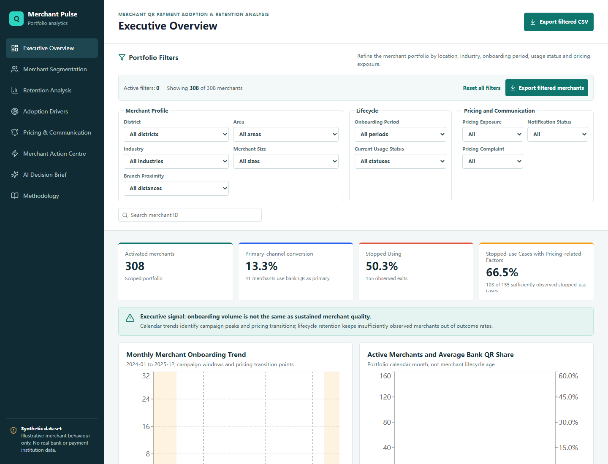
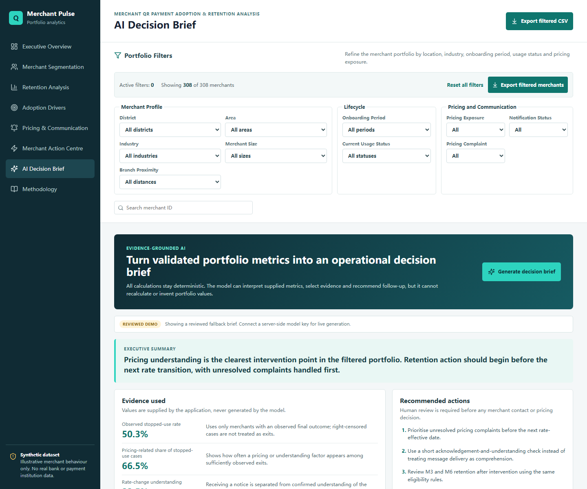

# Merchant Growth Intelligence

An evidence-grounded AI and analytics product for understanding merchant QR-payment activation, retention, pricing communication and operational follow-up.

[View the current analytics demo](https://merchant-qr-retention-analysis.netlify.app/) · [Read the methodology](docs/METHODOLOGY.md) · [See the AI architecture](docs/AI_ARCHITECTURE.md)

> Portfolio project by Yilin Yang. All merchant records, pricing regimes, formulas, campaigns and outcomes are synthetic. No bank, merchant or payment-institution data is used.



<details>
<summary>View the evidence-grounded AI decision brief</summary>



</details>

## Why this product exists

Merchant onboarding is not the same as sustained usage. A portfolio can acquire many merchants while losing them later through pricing expectation gaps, weak activation habits or unresolved operational friction.

This product connects three layers:

1. **Reliable measurement** - explicit activation, M3/M6 retention, right-censoring and pricing rules.
2. **Operational exploration** - portfolio filters, cohort views, merchant timelines and exportable action lists.
3. **Evidence-grounded AI** - an optional decision brief that can interpret validated metrics but cannot invent or recalculate them.

## Product capabilities

- Explore 308 synthetic merchants across 24 portfolio months.
- Compare calendar trends with merchant-lifecycle cohorts.
- Distinguish activation, sustained usage and primary-channel conversion.
- Preserve `N/A` for merchants without a sufficient observation window.
- Analyse four configurable synthetic pricing regimes.
- Trace notification delivery, acknowledgement and confirmed understanding separately.
- Filter the portfolio and export the complete filtered action list.
- Generate a structured AI decision brief with evidence, actions and limitations.

## AI design

The model is intentionally downstream of the metric engine:


The browser never receives an API key. The model selects documented metric keys and writes interpretations; the server injects the corresponding values from the application snapshot. If no key is configured or the request fails, the product shows a clearly labelled reviewed fallback rather than pretending a live model ran.

See [AI architecture and guardrails](docs/AI_ARCHITECTURE.md) and [evaluation plan](docs/AI_EVALUATION.md).

## Tech stack

- React 19, TypeScript and Vite
- Recharts and Papa Parse
- Deterministic TypeScript data generator and validation scripts
- Netlify Functions
- Optional OpenAI Responses API with Structured Outputs

## Run locally

```bash
npm install
npm run check:all
npm run dev
```

The Vite-only development server automatically demonstrates the reviewed fallback if the Netlify function is unavailable.

To run the serverless function locally, install the Netlify CLI and use:

```bash
npx netlify dev
```

## Optional live AI configuration

Copy `.env.example` to a local `.env` only for development, or add the variables in the Netlify site configuration:

```text
OPENAI_API_KEY=your_server_side_key
OPENAI_MODEL=gpt-4o-mini
```

Never use a `VITE_` prefix for the API key. Vite-prefixed variables are bundled into browser code.

## Validation

The included validation script checks lifecycle eligibility and the final metric denominators. Current deterministic results:

| Metric | Numerator | Denominator |
|---|---:|---:|
| 30-day activation | 282 | 283 |
| M3 retention | 222 | 253 |
| M6 retention | 72 | 226 |
| Observed stopped use | 155 | 227 |

These values are portfolio-demo outputs, not real-world performance claims.

## Repository guide

```text
src/                  React product and deterministic metric logic
scripts/              Synthetic-data generation and validation
netlify/functions/    Server-side AI decision-brief endpoint
docs/                 Methodology, data dictionary and AI design
```

## Boundaries

- Synthetic, experience-informed assumptions only.
- Descriptive analysis, not causal inference or financial advice.
- No automated merchant contact or pricing changes.
- Human review is required before operational action.

## Author

Yilin Yang - International Accounting master's student at City University of Hong Kong and former banking-operations professional building auditable AI and data products.

## License

MIT License. See [LICENSE](LICENSE).
